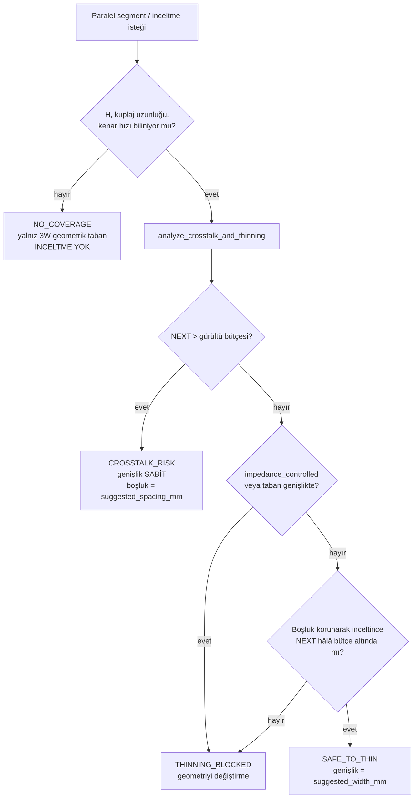

# SKILL: Crosstalk Taraması & Güvenli İz İnceltme

Ortak kapı kuralları: [[../_shared/coverage-gate.md]] ·
Metrik adları: [[../_shared/glossary.md]] §1

> Bu skill bir **tarama (screening)** kapısıdır, imza kapısı değil.
> `model_class: exploratory_closed_form`, `signoff: false`. Kontrollü empedanslı
> veya hızlı arayüzlerde field solver zorunlu kalır →
> [[../empedans-stackup/SKILL|empedans-stackup]].

## 0. Ne zaman çağrılır — zorunlu tetikleyiciler

İki iz **paralel** gidecekse veya mevcut bir izi **inceltmek** istiyorsan,
geometriyi yazmadan ÖNCE `analyze_crosstalk_and_thinning` çağrılır. Tetikleyici
üç durum:

1. Yeni bir paralel segment planlıyorsun (bus, adres/veri hattı, kontrol grubu).
2. Alan kazanmak için mevcut bir izi inceltmek istiyorsun.
3. Bir izi başka bir ize yaklaştırmak istiyorsun (boşluk küçültme).

**Tool'u çağırmadan geometri yazmak bu skill'in ihlalidir.**

## 1. Karar akışı



| status | Ne yaparsın | Ne YAPMAZSIN |
|---|---|---|
| `SAFE_TO_THIN` | `suggested_width_mm` ile incelt, `spacing_mm` **korunur** | Boşluğu ayrıca küçültmezsin — o ayrı bir tarama ister |
| `CROSSTALK_RISK` | Boşluğu `suggested_spacing_mm`'e aç (3W kuralı) | **Asla inceltmezsin** |
| `THINNING_BLOCKED` | Geometriyi olduğu gibi bırak; taban altındaysa genişlet | Alan kazanmak için zorlamazsın |
| `NO_COVERAGE` | Eksik girdiyi (H / uzunluk / kenar hızı) çöz, yeniden çağır | GREEN saymazsın, inceltmezsin |

## 2. Girdi/çıktı sözleşmesi

MCP tool: `analyze_crosstalk_and_thinning` (sunucu `pcb-crosstalk`).
Motor: [`tools/scripts/crosstalk_thinning.py`](../../tools/scripts/crosstalk_thinning.py) —
CLI olarak da çalışır, MCP olmadan da denetlenebilir.

**CLI sözleşmesi:** girdiler ya doğrudan bayraklarla ya da
`--input-json <dosya>` ile verilir. **`--json <dosya>` artık YAZAR** (rapor
çıktısı); girdi okumak için `--input-json` kullan. `--self-test` kanonik
doğrulama bayrağıdır.

**Zorunlu:** `trace_width_mm`, `spacing_mm` (kenar-kenar, merkez-merkez DEĞİL).

**EM kararı için zorunlu üçlü** — biri eksikse sonuç `NO_COVERAGE`:
`dielectric_height_mm` (H, en yakın referans düzlemine),
`coupled_length_mm` (paralel gidilen uzunluk), `rise_time_ps` (kenar hızı).

**Kararı değiştiren diğer alanlar:** `layer_type` (microstrip|stripline),
`impedance_controlled`, `noise_budget_ratio` (varsayılan 0.05),
`current_a` + `delta_t_c`, `fab_min_width_mm` / `fab_min_clearance_mm`,
`reference_plane_continuous`, `er`, `copper_weight_oz`, `net_class`.

### Girdiyi nereden alırsın — uydurma

| Alan | Kaynak | Uydurulursa |
|---|---|---|
| `dielectric_height_mm`, `er` | `stackup.json` / fab stackup | `NO_COVERAGE` |
| `rise_time_ps` | Sürücü datasheet'i (tR/tF, tipik değil **min**) | `CONFIRM` |
| `impedance_controlled` | `impedance_rules.json` net-class | Sessiz Z0 ihlali |
| `fab_min_*` | `fab_capabilities.json` | `LOCAL_POLICY` 0.15 mm tabanı |
| `noise_budget_ratio` | Alıcı gürültü marjı (VIH/VIL) | `LOCAL_POLICY` %5 |
| `current_a` | Güç ağacı / rail bütçesi → [[../guc-isil/SKILL|guc-isil]] | Akım tabanı hesaplanmaz |

`rise_time_ps` için **tipik değil, minimum** (en hızlı) kenarı kullan; datasheet
tipik değeri en kötü durumu temsil etmez. Aynı değer `phy_contract.json`'daki
`rise_time_ps` ile tutarlı olmalıdır.

## 3. Elektromanyetik görüş — hat çekerken aklında tutulacaklar

**İnceltmek tek başına crosstalk'ı azaltmaz.** Kuplajı belirleyen şey iz
genişliği değil, **merkez-merkez mesafenin referans düzlemi yüksekliğine
oranıdır** (`D/H`):

```
kx = 1 / (1 + (D/H)²)        D = S + W  (merkez-merkez)
Kb = 0.25 · kx               geri-yönlü (NEXT) kuplaj, doyumda 0.25 tavanı
NEXT = Kb · min(1, L / L_sat)    L_sat = tr · v / 2
```

Buradan çıkan dört pratik sonuç — routing sırasında bunları uygula:

1. **H'ı küçültmek, boşluğu büyütmekten güçlüdür.** `D/H` oranı karesel girer.
   İnce prepreg ile referans düzlemini yaklaştırmak, aynı kartta hem crosstalk'ı
   düşürür hem izleri sıklaştırmana izin verir. Bu bir **stackup kararıdır**,
   routing kararı değil → [[../empedans-stackup/SKILL|empedans-stackup]].
2. **Boşluk korunarak yapılan inceltme merkez-merkez mesafeyi KÜÇÜLTÜR** ve
   kuplajı **artırır**. Alan kazancı bedavaya gelmez; tool bu yüzden inceltilmiş
   W' için NEXT'i `D' = S + W'` ile yeniden hesaplar.
3. **Kenar hızı belirleyicidir, saat frekansı değil.** 100 MHz saatli ama 150 ps
   kenarlı bir sürücü, 500 MHz saatli 1 ns kenarlıdan daha agresif kuplar.
   `rise_time_ps` datasheet'ten gelir; tahmin edilirse `CONFIRM`'dür.
4. **Kuplaj uzunluğu doyum uzunluğunun (`L_sat`) altındaysa NEXT ölçeklenir.**
   Kısa paralellik tam genlikli NEXT üretmez — 2 mm'lik bir yanaşma için kart
   yeniden düzenlenmez. Uzun paralellikte ise NEXT doyar; daha da uzatmak
   NEXT'i artırmaz ama **FEXT'i artırır**.

### Bütçe aşıldığında sıralı çareler

Boşluk açmak tek çare değildir; kart alanı bitiyorsa sırayla:

| Çare | Etki | Maliyet |
|---|---|---|
| Boşluğu aç (3W) | `D/H` büyür, kuplaj karesel düşer | Kart alanı |
| Kuplaj uzunluğunu kısalt | NEXT doğrusal düşer (L < L_sat iken) | Yerleşim değişikliği |
| H'ı küçült (ince prepreg) | En güçlü kaldıraç, `D/H` karesel | Stackup revizyonu, fab maliyeti |
| Araya GND guard + stitching via | Yalnız **düzgün via'lanmış** guard işe yarar | Alan + via; via'sız guard etkisizdir |
| Katmanları ortogonal ayır | Paralel kuplaj yok olur | Via + katman bütçesi |
| Saldırganı yavaşlat (seri direnç) | Kenar hızı düşer, NEXT düşer | Zamanlama marjı |

> **Via'sız guard trace zararlıdır.** Uçları ve boyunca düzenli GND via'sı
> olmayan guard iz, rezonant bir anten gibi davranır ve kuplajı artırabilir.
> Guard koyacaksan λ/20 dikiş aralığını `stitch_density.py` ile ölç ve
> frekansı **`f_knee_edge`**'den türet ([[../_shared/glossary.md]] §1).
> Dikiş kuralının kanonik sahibi: [[../emc-esd/SKILL|emc-esd]] §Stitching.

### FEXT modellenmiyor — bunu bilerek taşı

Mikroşerit **inhomojen** ortamdır (üstü hava, altı dielektrik); çift ve tek mod
hızları farklıdır, bu yüzden **FEXT sıfır değildir** ve uzun kuplajda NEXT'i
geçebilir. Bu araç FEXT'i **hesaplamaz** ve mikroşerit girdisinde bunu her zaman
`CONFIRM` olarak yayınlar. Uzun paralel mikroşerit segmentlerinde field solver
zorunludur. Stripline homojendir → FEXT teorik olarak sıfırdır.

## 4. Uygulanmış örnekler

**A — sıkı kuplaj, inceltme yasak**

```
--trace-width-mm 0.20 --spacing-mm 0.10 --dielectric-height-mm 0.20
--coupled-length-mm 60 --rise-time-ps 200

CROSSTALK_RISK / NEXT_OVER_BUDGET
NEXT 7.69% > bütçe 5.00%     genişlik 0.20 mm SABİT
boşluk 0.10 -> 0.40 mm       (3W=0.40, bütçe-çözümü=0.20, fab=0.15 -> max)
önerilen boşlukta NEXT 2.50%
```

Bütçe çözümü 0.20 mm dediği halde 3W kuralı 0.40 mm istiyor; tool **en kısıtlayıcı
olanı** seçer. Model bir kuralı gevşetmek için kullanılmaz.

**B — geniş boşluk, inceltme serbest ama Z0 uyarısı**

```
--trace-width-mm 0.40 --spacing-mm 1.60 --dielectric-height-mm 0.10
--coupled-length-mm 20 --rise-time-ps 500 --current-a 0.5

SAFE_TO_THIN / NEXT_UNDER_BUDGET
genişlik 0.40 -> 0.15 mm (%62.5 kazanç), boşluk 1.60 mm KORUNUR
taban: fab=0.15, IPC-2221 akım=0.116  -> 0.15 mm bağlayıcı
NEXT 0.04%
CONFIRM: Z0 %158.8 değişiyor (19.0 -> 49.2 Ω) — kaynak/yük uyumunu ve IR düşümünü kontrol et
```

İkinci satır bu skill'in özüdür: **crosstalk serbest bıraksa bile Z0 kararı
bağımsızdır.** %158 Z0 kayması kontrolsüz bir netde bile kabul edilmez;
`CONFIRM` çözülmeden geometri yazılmaz.

## 5. Bilinen sınırlar — bu skill neyi KANITLAYAMAZ

| Konu | Seviye | Neden |
|---|---|---|
| FEXT | — | Modellenmez; mikroşerit girdisinde daima `CONFIRM` |
| Gerçek Z0 / Zdiff | D | Kapalı-form; field solver + kupon gerekir |
| Kontrollü empedanslı net PASS'i | — | `signoff: false`; bu tarama tek başına PASS üretmez |
| Guard trace etkinliği | C→D | Via'lanma kalitesine bağlı; 3B EM veya ölçüm |
| Çok-agresörlü toplam gürültü | — | Araç iki-iz modelidir; N-agresör toplamı hesaplanmaz |

## 6. Doğrulama

```bash
python3 tools/scripts/crosstalk_thinning.py --self-test           # fault-injection dahil
python3 -m unittest -v tools.tests.test_crosstalk_thinning        # motor sözleşmesi
python3 -m unittest -v tools.tests.test_crosstalk_mcp             # protokol + sözleşme
echo '{"jsonrpc":"2.0","id":1,"method":"tools/list"}' | python3 tools/servers/crosstalk_mcp_server.py
```

Fault-injection bloğu `KB_MAX`'i 0'a çekerek kuplajı yok sayar; test paketi bu
durumda `CROSSTALK_RISK`'in kaybolduğunu **gözlemleyerek** testin boş olmadığını
kanıtlar.

## 7. Kabul kriterleri

- [ ] Her paralel segment için tool **geometri yazılmadan önce** çağrıldı.
- [ ] Tool çıktısı `crosstalk_scan.json` olarak saklandı; her paralel segment
      bir kayıt. `coverage.scanned` = taranan segment sayısı.
- [ ] **Taranmamış paralel segment `excluded` olarak sayıldı ve gerekçelendirildi.**
      Sayılmayan segment `NO_COVERAGE`'dır, PASS değildir.
- [ ] `SAFE_TO_THIN` uygulanan her yerde `spacing_mm` **korundu**; boşluk ayrıca
      küçültülmedi.
- [ ] `CROSSTALK_RISK` çıkan hiçbir segmentte inceltme yapılmadı.
- [ ] `impedance_controlled` net hiçbir yerde inceltilmedi.
- [ ] `rise_time_ps` datasheet **minimum** kenarından alındı; tahminse `CONFIRM`.
- [ ] Her `CONFIRM` (özellikle Z0 kayması) geometri yazılmadan önce çözüldü.
- [ ] `SAFE_TO_THIN` uygulandıysa genişlik DRC net-class'ına da yansıtıldı →
      [[../dfm/SKILL|dfm]] §DRC kural enjeksiyonu. DRC geometriyi korur,
      crosstalk'ı doğrulamaz.
- [ ] Mikroşerit segmentlerde FEXT `CONFIRM`'ü taşındı, sessizce düşürülmedi.
- [ ] Bu araç **hiçbir board/şematik dosyasına yazmadı**; geometriyi uygulamak
      [[../highspeed-routing/SKILL|highspeed-routing]]'in işidir.
- [ ] `signoff: false` olduğu için bu tarama tek başına hızlı arayüz PASS'ı
      üretmedi; D/L3 kanıtı field solver veya kupon ölçümüdür.
- [ ] coverage: `scanned + excluded == eligible`, `scanned > 0`.

## İlgili

[[../empedans-stackup/SKILL|empedans-stackup]] · [[../emc-esd/SKILL|emc-esd]] ·
[[../highspeed-routing/SKILL|highspeed-routing]] · [[../dfm/SKILL|dfm]] ·
[[../dogrulama-matrisi/SKILL|dogrulama-matrisi]]
